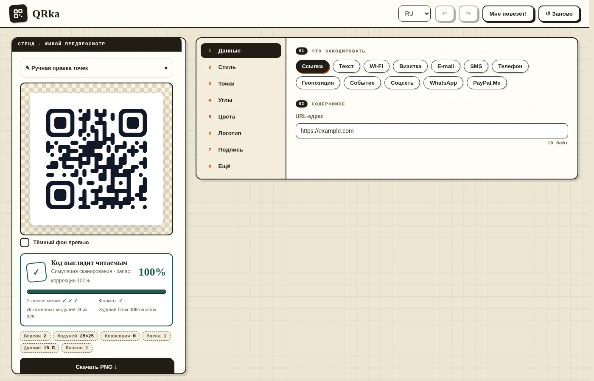

# QRka

QRka помогает создать QR-код, настроить его оформление и скачать готовый файл.

<div align="center">
  <a href="https://mbMayer.github.io/QRka/"></a>
</div>



## Возможности

- **Типы данных:** ссылка, текст, Wi‑Fi, визитка vCard, e-mail, SMS, телефон, геопозиция, событие, соцсети, WhatsApp и PayPal.Me.
- **Дизайн:** 12 форм модулей, индивидуальная форма модулей, оформление угловых меток, цвета, градиенты, палитры, рамки и подписи.
- **Изображения:** логотип в центре и картинка на фоне; кадрирование, масштаб, смещение и регулируемый слой для контраста.
- **Ручная правка:** перекрашивайте модули, меняйте их форму или отменяйте правки. Предварительная оценка показывает повреждения и запас коррекции, но не заменяет проверку камерой.
- **Экспорт:** PNG, SVG, JPG, PDF для A4/A5/Letter, наклеек 50×50 мм, визиток 85×55 мм и произвольного размера; сохранение и восстановление проекта в JSON.

## Запуск

### С сайта GitHub Pages

Откройте **[QRka в браузере](https://mbMayer.github.io/QRka/)** — установка не нужна.

### Локально

Откройте `index.html` в браузере. Если браузер ограничивает работу с локальными файлами, запустите сервер из каталога проекта:

```bash
python3 -m http.server 8000
```

Затем откройте <http://localhost:8000>.

## Горячие клавиши

| Клавиша | Действие |
| --- | --- |
| `V` | Выбор элемента |
| `B` | Кисть |
| `M` | Включить/выключить модуль |
| `S` | Изменить форму модуля |
| `E` | Ластик |
| `Ctrl+Z` | Отменить |
| `Ctrl+Shift+Z` | Повторить |
| `Ctrl+V` | Вставить картинку как логотип |

## Печать

Перед печатью наведите на код камеру телефона: предварительная оценка в приложении не гарантирует, что каждый сканер его прочитает.

## Лицензия

Код распространяется по лицензии [MIT](LICENSE). Шрифты в `assets/fonts` — Inter и Playfair Display под [SIL Open Font License](https://openfontlicense.org/).
